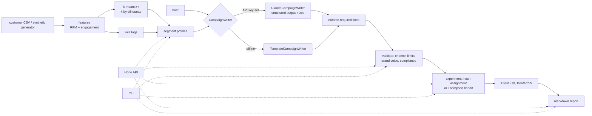

# campaign-forge

campaign-forge takes a customer CSV and turns it into audience segments, then writes campaign copy for a segment and runs the experiment that compares the variants. It computes recency/frequency/spend and per-channel engagement features, clusters customers with a from-scratch k-means (k-means++ seeding, k picked by exact silhouette score), and adds rule-based tags. Each segment gets a readable profile. That profile and a marketing brief go to a pluggable copy writer: Claude with zod-validated structured output, or an offline deterministic template writer. Every variant then passes through channel limits, a brand-voice filter and compliance checks. Experiments use deterministic hash-based A/B/n assignment and are analysed with hand-written statistics (two-proportion z-test, Wilson intervals, sample-size calculator), with a Thompson-sampling bandit as an alternative. The statistics are checked against independent reference values and by simulation, not only against themselves.

All bundled customer data is **synthetic** (IDs like `SYN-000001`, fictional brand "Northwind Coffee").

## Features

- **Segmentation**: CSV import with per-row zod validation and line-numbered errors, plus a seeded synthetic generator with four hidden personas. Feature engineering covers recency, frequency, spend, tenure and Laplace-smoothed email/SMS/push engagement, log-transformed and z-scored before clustering. k-means is implemented from scratch with k-means++ seeding and seeded restarts, and k is chosen by silhouette score over 2..8. Seven rule tags (`vip`, `lapsed`, `new`, `win_back`, channel-engaged) are added on top, and each segment gets a profile such as "High-value · active · email-first" with a one-sentence description.
- **Campaign generation**: a brief (brand, product, goal, tone, channel = email/SMS/push/social, optional offer) plus a segment profile produces up to 5 variants, each with a headline/subject, body and CTA.
  - `ClaudeCampaignWriter` uses `@anthropic-ai/sdk` with model `claude-opus-5-5`, `output_config.format` JSON schema, `effort: "medium"` and the server-side refusal fallback. It checks `stop_reason` (refusal and max_tokens are errors) and re-validates the output with zod.
  - `TemplateCampaignWriter` is offline and deterministic. It is selected automatically when `ANTHROPIC_API_KEY` is unset.
- **Enforcement**: channel limits (email subject ≤ 60, SMS body + CTA ≤ 160, push and social limits) and a banned-words list for brand voice. Compliance checks require an unsubscribe line in email and STOP opt-out in SMS, reject unverifiable claims ("guaranteed", "risk-free", "clinically proven", ...), and require a disclaimer whenever "free" is offered. Mechanical lines (unsubscribe footer, STOP, "Terms apply.") are added automatically. Content problems such as claims and banned words mark the variant `approved: false` with the reasons.
- **Experimentation**: deterministic SHA-256 assignment with weights, and a two-sided two-proportion z-test with Bonferroni correction for A/B/n. Also included: Wald intervals for the difference, Wilson intervals per arm, a minimum-sample-size calculator, a Beta-Bernoulli Thompson sampler with P(best), and a seeded experiment simulator.
- **Interfaces**: an HTTP API (Hono) and a CLI. Both can create segments, generate variants, assign users, analyse results, simulate experiments and render a markdown report.

## Architecture



- **No ML or stats dependencies.** k-means, silhouette, the normal CDF and quantile (Marsaglia series, Acklam plus a Halley step), the z-test, the Wilson interval and Beta sampling (Marsaglia-Tsang gamma) are all in `src/`. That keeps the math auditable, and the tests compare it against values from Python's `statistics.NormalDist` and textbook examples.
- **The LLM is behind a one-method `CampaignWriter` interface.** The pipeline never trusts the writer: Claude output is schema-constrained by the API, re-validated with zod, and then put through the same validator as the template writer's output. A model that writes "guaranteed" is rejected the same way a person would be.
- **Fix what is mechanical, reject what needs judgement.** Missing unsubscribe/STOP/disclaimer lines are appended. Claims and banned words are not rewritten automatically, because silently editing claims changes meaning.
- **Everything is seeded.** The data generator, k-means restarts, bandit and simulator take seeds, and assignment is a pure hash of `(experimentId, userId)`, so runs and benchmarks are reproducible.
- **State is in memory.** The API keeps segmentations, campaigns and experiments in an in-memory workspace. That suits a single-process demo and keeps the code focused on the domain logic.

## Quickstart

Requires Node 24.

```bash
npm install
npm run cli -- segment data/customers.csv          # bundled 2,000 SYNTHETIC customers
```

```
k = 4 (silhouette 0.523)

| id | segment | size | median recency (d) | median orders | median spend | common tags |
|---|---|---|---|---|---|---|
| 0 | Mid-value · lapsed · email-first | 588 (29%) | 224 | 5 | $272 | lapsed, win_back |
| 1 | High-value · active · email-first | 513 (26%) | 12 | 14 | $1115 | email_engaged, vip |
| 3 | Mid-value · cooling · sms-first | 497 (25%) | 33 | 8 | $215 | sms_responsive |
| 2 | Low-spend · active · push-first | 402 (20%) | 14 | 1 | $55 | push_responsive, new |
```

Generate SMS variants for segment 3 (offline template writer, since no API key is set):

```bash
npm run cli -- campaign data/customers.csv --brief examples/brief-sms.json --segment 3
```

```
Writer: `template`, channel: sms, segment 3

- **A** approved
  - body: Northwind Coffee: Your Winter Roast is waiting. Enjoy 20% off your next bag. Reply STOP to opt out.
  - CTA: Shop now: https://example.com/w
...
```

Simulate a 3-arm test, first with a fixed split and then with Thompson sampling:

```bash
npm run cli -- simulate --rates 0.05,0.06,0.055 --users 30000
npm run cli -- simulate --rates 0.05,0.06,0.055 --users 30000 --strategy thompson
```

```
| variant | users | conversions | rate [95% CI] | lift vs control | p | p (Bonferroni) |
|---|---|---|---|---|---|---|
| A | 9945 | 477 | 4.80% [4.39%, 5.23%] | control | - | - |
| B | 10043 | 603 | 6.00% [5.56%, 6.49%] | 25.2% | 0.000159 | 0.000318 |
| C | 10012 | 547 | 5.46% [5.04%, 5.93%] | 13.9% | 0.0327 | 0.0654 |

Winner: **B**

Regret: 149.5, best-arm share: 33.5%
```

With `--strategy thompson` the same setup gives regret 36.5 and 85.2% of traffic on B, but B is no longer significant (p = 0.088, Bonferroni 0.177) because the control got only 2,871 users.

Other commands: `sample-size --baseline 0.1 --mde 0.02` prints `{"perArm": 3841}`. `report data/customers.csv --brief examples/brief-email.json` runs segment, then campaign, then a simulated experiment, and prints one markdown report. `generate-data --n 5000 --seed 7 --out my.csv` writes new synthetic data.

### HTTP API

```bash
npm run serve        # http://localhost:3000, writer chosen from ANTHROPIC_API_KEY
curl -X POST localhost:3000/segments -H 'content-type: application/json' -d '{"synthetic":{"n":500,"seed":7}}'
curl -X POST localhost:3000/campaigns -H 'content-type: application/json' \
  -d '{"segmentationId":"seg-1","segmentId":0,"brief":{"brand":"Northwind Coffee","product":"Winter Roast","goal":"conversion","tone":"playful","channel":"sms","offer":"free shipping","url":"https://example.com/w","variantCount":2}}'
```

```json
{"id":"cmp-2","writer":"template", ..., "variants":[{"id":"A","headline":null,
 "body":"Northwind Coffee: Your Winter Roast is waiting. Enjoy free shipping. Terms apply. Reply STOP to opt out.",
 "cta":"Shop now: https://example.com/w","issues":[],"approved":true}, ...]}
```

| method | path | purpose |
|---|---|---|
| POST | `/segments` | `{csv}` or `{synthetic: {n, seed}}`: segment and profile |
| GET | `/segments/:id` | full segmentation incl. per-customer assignments |
| POST | `/campaigns` | `{brief, segmentationId, segmentId}` or `{brief, profile}`: validated variants |
| POST | `/experiments` | `{name, variants, weights?}` |
| GET | `/experiments/:id/assign/:userId` | deterministic variant for a user |
| POST | `/experiments/:id/results` | `{arms: [{variant, users, conversions}]}`: analysis |
| POST | `/simulations` | `{rates, users, strategy: fixed\|thompson, seed}` |
| GET | `/sample-size?baseline=&mde=&alpha=&power=` | users per arm |
| GET | `/report` | markdown report of the workspace |

To use Claude, copy `.env.example`, set `ANTHROPIC_API_KEY` in your environment, and the CLI and API switch to `ClaudeCampaignWriter`. I have not run or measured it against the live API (see Limitations).

## Results

Measured with `npm run bench` on 2026-11-06: 12th Gen Intel Core i7-12700 (16 logical cores), Windows 11 (Windows_NT 10.0.26300), Node v24.14.0. Data is synthetic (generator seeds 42, 1-4, 2,000 customers each) plus the 50 hand-labelled messages in `bench/compliance-set.json`. **All numbers are offline-baseline numbers:** the template writer and rule-based checker, with no LLM involved. Full output is in [`bench/RESULTS.md`](bench/RESULTS.md).

| what | metric | result |
|---|---|---|
| Segmentation (5 synthetic datasets × 2,000) | chosen k (true personas = 4) | 4 on 5/5 datasets |
| | mean silhouette | 0.526 |
| | mean purity vs hidden personas | 0.992 |
| | time for features + k=2..8 + silhouette | 0.23-0.33 s per dataset |
| Compliance checker (50 labelled messages, 27 labelled violations) | micro precision / recall / F1 | 0.800 / 0.741 / 0.769 |
| | message-level precision / recall | 0.783 / 0.720 |
| | weakest rule: `unverifiable_claim` P / R | 0.786 / 0.688 |
| Bandit vs fixed split (4 arms 4/4.5/5/6%, 20k users, 50 seeds) | mean regret, fixed → Thompson | 225.0 → 62.3 (-72%) |
| | traffic to best arm, fixed → Thompson | 25.0% → 75.9% |
| | runs where best arm is the significant winner | fixed 49/50, Thompson 22/50 |
| Variant validation throughput (single thread) | median variants/s | 406,566 |

How to read these:
- **Purity is high because the generator's personas are well separated.** It shows the clustering and k-selection work end to end. It does not predict performance on real customer data.
- **The labelled message set was written to contain hard cases.** Examples include "100% Arabica" (a true fact), "sugar free" (not an offer), "Freebie inside" (an offer without the word "free") and "Loved by 2 million customers" (an unsubstantiated statistic). Keyword rules miss or mis-flag these, and the results list every disagreement.
- **The bandit trades inference for reward.** It loses fewer conversions, but because the control is starved of traffic, the corrected z-test confirms the winner less often.
- Throughput varies between runs on this machine (medians of 329k-407k variants/s across four runs). The table shows the run that produced `bench/RESULTS.md`.

## Tests / CI

```bash
npm run typecheck && npm run lint && npm test
```

49 tests in 5 files (vitest) cover:
- **Statistics**: CDF and quantile against Python `statistics.NormalDist` to 1e-10/1e-12, z-test p-values and intervals against reference computations, the Wilson 81/263 textbook example, and sample sizes (3841 for 10% → 12%). Simulation checks: the type I error stays in [0.04, 0.06] under the null, and the calculated sample size achieves 0.77-0.83 power.
- **Clustering**: k-means recovers separated blobs, the exact silhouette value on a 4-point example, k selection, and purity.
- **Data**: CSV round-trip and line-numbered errors.
- **Copy**: every compliance rule, plus the template writer passing validation for all 4 channels × 4 goals × 4 tones.
- **Claude writer**: tested with a fake client. Checks cover the request shape (model, effort, schema, fallback header, no sampling params), refusal, truncation, invalid output and error mapping.
- **API**: the full flow through `app.request`.

No test calls the network. GitHub Actions (`.github/workflows/ci.yml`) runs `npm ci`, typecheck, Biome lint, tests and the benchmark on Node 24.

## Limitations and next steps

- **Synthetic data only.** The generator's four personas are deliberately separable. Real customer bases cluster less cleanly, and k chosen by silhouette alone can be unstable.
- **Silhouette is exact O(n²).** That is fine for a few thousand customers. Larger imports need sampling or a simplified silhouette.
- **The compliance checks are keyword and regex rules, not legal advice.** They score F1 0.77 on a small set I wrote and labelled myself (50 messages), and they miss paraphrased claims ("twice the energy", "zero risk"). An LLM or classifier second pass is the obvious next step and should be measured on a larger, independently labelled set.
- **The Claude writer is untested against the live API.** It is unit-tested against a mocked SDK client, and I have no measurements of Claude copy quality or compliance pass rate. The recorded numbers all use the offline template writer.
- **The template writer is simple.** Its copy is grammatical but formulaic (3 templates per goal/tone).
- **The statistics are classical fixed-horizon tests.** There is no sequential testing or peeking correction, Bonferroni is conservative, and the bandit has no stopping rule or minimum exposure per arm.
- **The API state is in memory with no auth or persistence.** The CSV parser does not support quoted fields containing commas.

## License

MIT © 2026 Bryant Le
